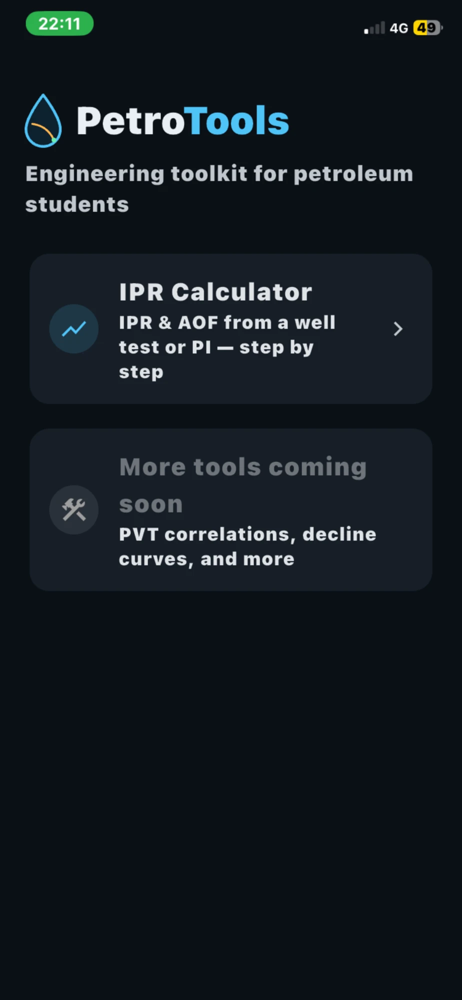
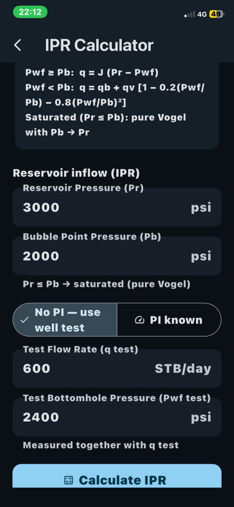
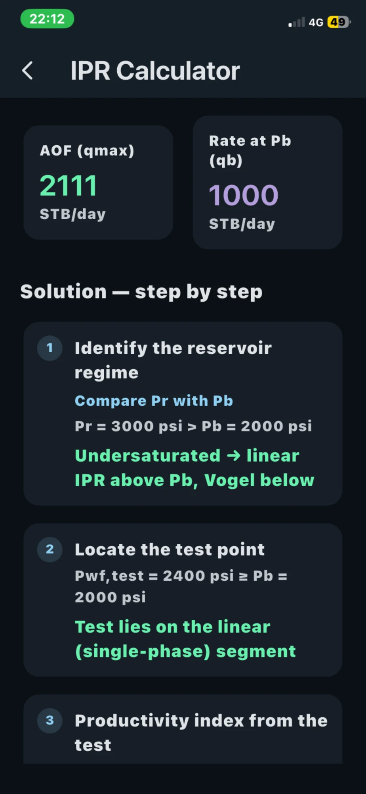
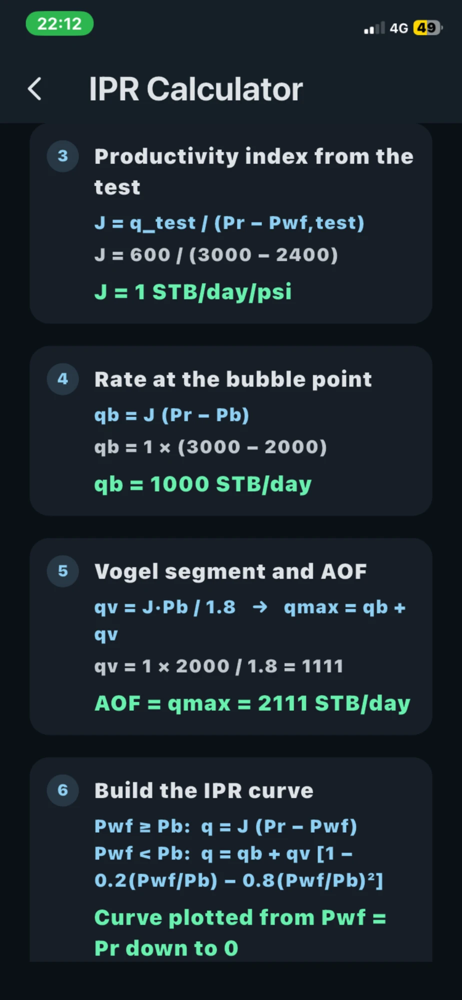
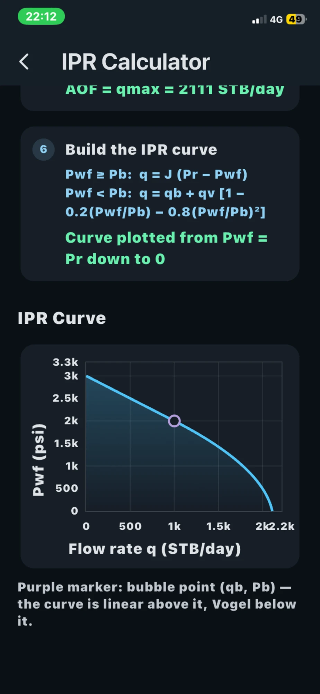

<div align="center">


# PetroTools

**An engineering toolkit for petroleum students — fast, offline, and explained step by step.**

[](https://flutter.dev)
[](https://dart.dev)
[]()
[](https://pub.dev/packages/fl_chart)
[]()

</div>

---

## 📱 Overview

**PetroTools** puts essential petroleum engineering calculations in your pocket. It is built for
students who want to check their work, study smarter, and stop rebuilding the same curves by hand
before every exam.

Everything runs **100% on-device** — no login, no internet, no data collection. Each result comes
with a **full step-by-step worked solution**: the formula, the substitution with real numbers, and
the final answer — so you learn the method, not just the number.

> This repository doubles as a portfolio project demonstrating clean Flutter architecture,
> domain-accurate engineering math, an interactive charting UI, and a complete app-store release
> pipeline (custom icon, splash screen, store metadata).

---

## ✨ Screenshots

<div align="center">

| Splash | Home | IPR Input |
|:------:|:----:|:---------:|
|  |  |  |

| Results & AOF | Step-by-step Solution | Interactive IPR Curve |
|:-------------:|:---------------------:|:---------------------:|
|  |  |  |

</div>

---

## 🧮 Features

### IPR Calculator (available now)
Builds the complete **Inflow Performance Relationship** curve for a well — even when the
productivity index is unknown.

- **Works without the PI** — enter a well test point (flow rate + bottomhole pressure) and the
  bubble point pressure, and the app derives the productivity index for you.
- **Physically correct composite model** — linear single-phase flow above the bubble point,
  **Vogel's equation** below it, handling all three cases:
  - Saturated reservoir (Pr ≤ Pb) → pure Vogel
  - Undersaturated, test above Pb → linear segment
  - Undersaturated, test below Pb → Vogel-corrected segment
- **AOF (Absolute Open Flow)** and the bubble-point rate computed and displayed.
- **Interactive chart** (built with `fl_chart`) with the bubble point marked.
- **Step-by-step solution** shown for every calculation — formula → substitution → result.

### Across the app
- 🌙 Clean, modern **dark UI** designed for long study sessions
- ⚡ **Fully offline** — all math runs locally, instantly
- 🔒 **Zero data collection** — no account, no analytics, no network calls
- 🧩 **Modular architecture** built to grow with new tools

---

## 🛠️ Tech Stack

| Area | Choice |
|------|--------|
| Framework | Flutter (iOS & Android from one codebase) |
| Language | Dart |
| Charts | [`fl_chart`](https://pub.dev/packages/fl_chart) |
| App icon | `flutter_launcher_icons` (adaptive + iOS) |
| Splash | `flutter_native_splash` |
| State | Lightweight `StatefulWidget` — no over-engineering |
| Testing | `flutter_test` — unit + widget tests |

---

## 🏗️ Architecture

The codebase is deliberately modular so new engineering tools can be added without touching
existing ones — a new tool is a new screen plus pure calculation functions.

```
lib/
├── main.dart                     # App entry, dark theme, native splash hold
├── models/
│   └── well_data.dart            # IprModel, TpcModel, CurvePoint, CalculationStep
├── utils/
│   └── nodal_calculations.dart   # Pure, tested engineering math (no UI)
├── widgets/
│   ├── ipr_input_form.dart       # Reusable reservoir-input section (test data / PI)
│   ├── ipr_chart.dart            # Interactive fl_chart curve + markers
│   ├── solution_steps.dart       # Numbered step-by-step solution cards
│   ├── input_field.dart          # Validated numeric field
│   └── logo_lockup.dart          # Brand lockup drawn with CustomPaint
└── screens/
    ├── home_screen.dart          # Tool launcher (data-driven, easy to extend)
    └── ipr_screen.dart           # IPR calculator
```

**Separation of concerns:** all engineering math lives in `nodal_calculations.dart` as pure
functions returning both the result *and* the worked steps — fully unit-tested and completely
decoupled from the UI.

---

## 🔬 The Engineering Behind It

The IPR is modeled as a composite curve:

```
Pwf ≥ Pb :  q = J · (Pr − Pwf)                                  (linear, single-phase)
Pwf < Pb :  q = qb + qv · [1 − 0.2(Pwf/Pb) − 0.8(Pwf/Pb)²]      (Vogel, two-phase)
```

When the productivity index is not provided, it is back-calculated from the well test point,
selecting the correct equation depending on whether the test was taken above or below the bubble
point — then `qb`, `qv`, and the AOF are derived and the full curve is sampled. The IPR/TPC
operating point (next tool) is solved numerically by bisection.

---

## ✅ Testing

```bash
flutter test
```

Unit tests cover all three IPR regimes, productivity-index back-calculation from test data,
inverse-function consistency, curve continuity at the bubble point, and the operating-point solver.
Widget tests verify the UI and state persistence.

---

## 🚀 Getting Started

```bash
git clone https://github.com/osmsmix/PetroTools.git
cd PetroTools
flutter pub get
flutter run
```

Requires Flutter 3.41+ / Dart 3.11+.

---

## 🗺️ Roadmap

PetroTools is a growing toolkit. Planned additions:

- [ ] Nodal analysis — operating point from Tubing Performance (TPC)
- [ ] PVT correlations
- [ ] Decline curve analysis

---

## 👨‍💻 About the Developer

Built by **Oussama Mohamed El Hadi** — Flutter developer building clean, cross-platform mobile apps
for iOS and Android.

**Available for freelance work.** I build polished Flutter apps from idea to App Store / Play Store
— including UI/UX, custom branding, and release.

<div align="center">

[](https://www.upwork.com/freelancers/~01825ff64c8093996f)
[](https://www.fiverr.com/s/Vrrklkz)
[](mailto:oussama.mohamedelhadi@gmail.com)
[](https://github.com/osmsmix)

</div>

---

## 📄 License

© 2026 Oussama Mohamed El Hadi. All rights reserved.

This source is published for portfolio and demonstration purposes. Please contact the author before
reuse or redistribution.
